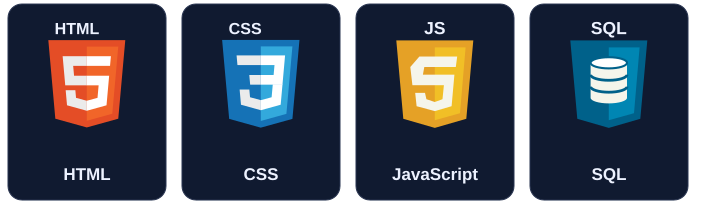
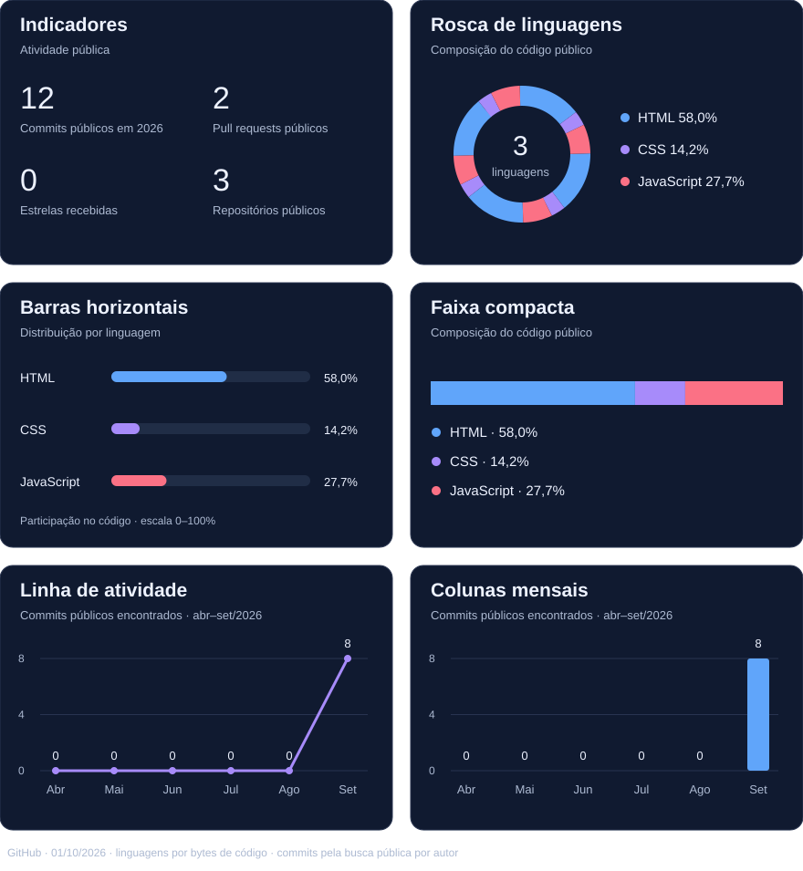

## Sobre mim

Estudante de **Engenharia de Software** (Cruzeiro do Sul), focado em **desenvolvimento web** e **banco de dados**.
Gosto de entender como as coisas funcionam, resolver problemas e transformar ideias em projetos práticos — do código ao deploy.

🎯 **Em busca de:** estágio ou vaga júnior em desenvolvimento web / suporte técnico / dados  
🌎 **Inglês avançado** — leio documentação e me comunico em inglês

## Tecnologias

**Front-end:** HTML5 · CSS3 · JavaScript (responsividade, DOM, Flexbox/Grid)  
**Banco de dados:** Modelagem conceitual e lógica · MySQL · SQL  
**Ferramentas:** Git · GitHub · VS Code · Docker · Linux

## Estudando agora

- 📚 Algoritmos e estruturas de dados
- 🗄️ Modelagem de Banco de Dados (projeto prático de controle de estoque e entregas)
- 🐳 Containers com Docker e administração Linux
- 🔐 Segurança da informação, com foco em desenvolvimento seguro

## Projetos em destaque

| Portfólio pessoal | Instituto Caminhos do Bem |
| --- | --- |
| Apresentação das minhas atividades, competências e projetos. | Projeto web desenvolvido para o Instituto Caminhos do Bem. |
| [Explorar projeto →](https://github.com/rafagiindro/Portfolio) | [Explorar projeto →](https://github.com/rafagiindro/ONG) |

## Atividade e linguagens

## 🐍 Snake

<picture>
  <source media="(prefers-color-scheme: dark)" srcset="https://raw.githubusercontent.com/rafagiindro/rafagiindro/output/github-snake-dark.svg">
  <source media="(prefers-color-scheme: light)" srcset="https://raw.githubusercontent.com/rafagiindro/rafagiindro/output/github-snake.svg">
  
</picture>

## 👻 Pac-Man

